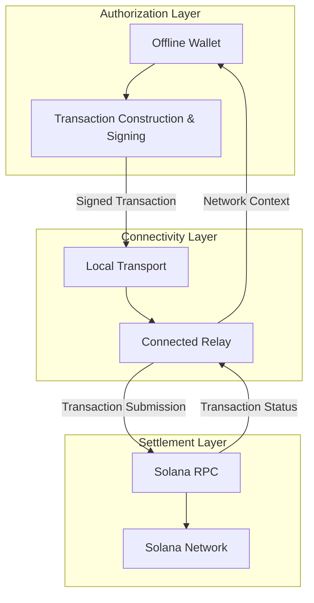
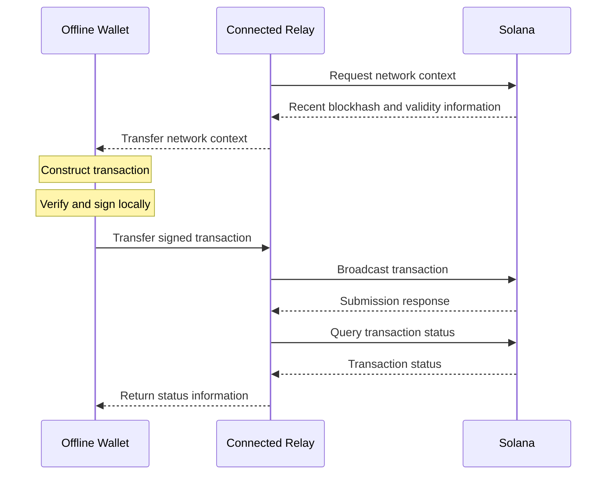

# RPay Protocol

**The connectivity layer for decentralized payments.**

[](https://solana.com/)
[](https://github.com/abdushakurob/rpay-protocol)
[](https://github.com/abdushakurob/rpay-protocol/issues)

[RPay](https://rpay-seven.vercel.app/) is a noncustodial transaction connectivity protocol that enables blockchain wallets to authorize and submit payments without requiring every participating device to maintain an independent internet connection.

Built initially on [Solana](https://solana.com/), RPay separates transaction authorization from network communication. Disconnected wallets sign transactions locally, while connected peers provide access to the blockchain for submission and settlement.

This enables a shared connectivity model in which a single connected device can relay transactions for multiple independently controlled wallets without receiving custody of their funds.

**One connection. Everyone can transact.**

## RPay Highlights

RPay introduces the following capabilities and design principles:

- **Offline transaction authorization:** Construct and sign blockchain transactions without direct internet access on the originating device.
- **Noncustodial transaction relaying:** Submit signed transactions through connected peers without exposing private keys or delegating spending authority.
- **Shared network connectivity:** Allow multiple wallets to access blockchain settlement through a single connected device.
- **Transport-independent architecture:** Separate transaction delivery from the underlying local communication mechanism, beginning with QR-based exchange.
- **Native Solana settlement:** Use Solana's existing transaction validation, execution, and finality mechanisms without introducing a separate settlement network.
- **Extensible financial infrastructure:** Establish a foundation for compatible wallets, relay services, merchant payment systems, and future autonomous financial applications.

RPay is designed to make network connectivity an accessible infrastructure resource rather than a prerequisite for every wallet.

## Why RPay?

Decentralized financial networks have expanded the ability to transfer and manage value without traditional intermediaries. However, accessing these networks still depends on reliable internet connectivity.

This dependency becomes a practical limitation in environments where connectivity is intermittent, expensive, or unevenly distributed.

Across parts of Africa and other emerging markets, access to smartphones and digital financial services does not always translate into consistent access to the networks supporting them.

RPay addresses this gap at the transaction delivery layer.

Instead of requiring every wallet to independently communicate with the blockchain, RPay allows disconnected devices to use nearby connected peers as transaction relays.

A wallet can authorize a payment locally, transfer the signed transaction through an available communication channel, and rely on a connected peer to submit it to the network.

The relay does not control the wallet's assets. It provides connectivity to the settlement network.

This distinction allows financial applications to operate across connectivity-constrained environments while preserving the authorization and ownership guarantees of the underlying blockchain.

Although emerging markets provide an important initial context, RPay's architecture is not geographically restricted.

## RPay Architecture

RPay separates transaction authorization, network connectivity, and settlement into three logical layers.



The authorization layer operates on the originator's device and retains control of transaction signing.

The connectivity layer provides communication between disconnected wallets and the blockchain network. It exchanges the network information required for transaction construction, transports signed payloads, and broadcasts authorized transactions.

The settlement layer validates and executes transactions according to Solana's native transaction rules.

RPay does not introduce a new blockchain, consensus mechanism, or settlement ledger. It extends access to existing blockchain infrastructure.

## How RPay Works

RPay uses a relay-assisted transaction flow in which a connected device supplies network access to an offline wallet.



The process involves four primary operations.

**Network context exchange.** The connected relay retrieves the blockchain information required to construct a valid transaction and makes it available to the disconnected wallet.

**Local authorization.** The wallet constructs the intended transaction and signs it using locally controlled credentials. Private keys remain on the originating device.

**Transaction relaying.** The signed transaction is transferred to the connected relay through a local transport, such as a QR code. The relay submits the transaction to Solana without modifying the signed message.

**Network settlement.** Solana validates and executes the transaction. The relay can retrieve and communicate its status, while the blockchain remains the authoritative source of settlement.

The recipient does not need to maintain an active internet connection for funds to be transferred to their address. However, a successful signature or relay submission alone does not establish completed settlement.

## Protocol Design

RPay is built around the separation of authorization and connectivity.

### Independent authorization

Transaction signing remains under the control of the originating wallet.

A connected relay cannot independently authorize transfers or modify signed transaction contents without invalidating the corresponding cryptographic signature.

### Noncustodial connectivity

Relays provide network access without taking custody of user assets.

A relay receives an authorized transaction payload rather than the credentials required to create arbitrary transactions on behalf of the wallet.

### Shared access

A single connected relay can provide blockchain access to multiple disconnected wallets.

Potential relay operators include other wallet users, merchants, payment agents, community gateways, and compatible financial applications.

### Transport abstraction

RPay's transaction model is independent of the local communication mechanism.

The reference implementation uses QR codes. Additional transports, such as Bluetooth, NFC, and local peer-to-peer communication, are potential extensions.

### Native settlement

RPay relies on the underlying blockchain for transaction validation and settlement.

The relay provides transaction delivery, not an alternative source of financial finality.

## Solana Integration

RPay's first implementation uses Solana as its settlement network.

Solana's transaction model allows transactions to be constructed and cryptographically signed separately from the device responsible for broadcasting them.

RPay uses this property to enable relay-assisted transaction delivery.

The protocol must account for Solana-specific requirements, including recent blockhash validity, transaction fees, signature verification, and confirmation states.

A relay cannot replace the recent blockhash in an already signed transaction without invalidating its signature. Expired transactions may require a new authorization.

RPay currently operates on **Solana Devnet** and is intended for experimentation and development.

## Security

RPay uses a noncustodial authorization model in which the relay does not require the originator's signing credentials.

Solana's cryptographic signature verification protects the integrity of authorized transaction messages.

However, relays are not assumed to be honest or continuously available.

A relay may withhold a transaction, delay submission, supply stale network information, or report an inaccurate transaction status.

RPay therefore distinguishes between transaction authorization, submission, confirmation, and final settlement.

The protocol does not guarantee transaction inclusion, relay availability, confidentiality, or fully offline settlement.

Security reviews and broader interoperability testing remain necessary before production deployment.

See [SECURITY.md](SECURITY.md) for security reporting and additional considerations.

## Reference Implementation

The RPay repository contains an experimental reference implementation demonstrating offline transaction authorization and relay-assisted submission on Solana Devnet.

The application uses:

- **React and TypeScript** for the wallet interface.
- **Solana Web3.js** for transaction construction, signing, and network interaction.
- **QR-based communication** for exchanging data between disconnected wallets and connected relays.
- **Encrypted local storage** for wallet credential persistence.
- **Progressive Web App capabilities** for browser-based deployment.

The reference implementation is not a normative requirement for future protocol clients.

Independent implementations may use different languages, frameworks, and transport mechanisms as the protocol specification evolves.

### Getting Started

Clone the repository:

```bash
git clone https://github.com/abdushakurob/rpay-protocol.git
cd rpay-protocol
```

Install dependencies:

```bash
npm install
```

Start the development server:

```bash
npm run dev
```

The application is available at [rpay-seven.vercel.app](https://rpay-seven.vercel.app/).

Use Solana Devnet test funds when experimenting with the protocol.

## Protocol Development

RPay is an experimental protocol under active development.

The initial implementation demonstrates the separation of transaction authorization from network connectivity through QR-based relaying.

Ongoing and proposed development areas include:

- Formalizing interoperable wallet-to-relay message formats.
- Defining protocol versioning and conformance requirements.
- Supporting independent relay implementations.
- Expanding local transport mechanisms.
- Improving transaction expiration and failure recovery.
- Exploring relay discovery and coordination.
- Developing interfaces for merchant systems and autonomous financial agents.
- Evaluating the protocol under real-world connectivity constraints.

The long-term objective is to establish an open connectivity layer through which financial applications can access decentralized settlement infrastructure without requiring every participating device to maintain its own network connection.

## Documentation

Technical documentation is organized around the protocol's architecture, transaction lifecycle, transport, security model, and Solana integration.

| Document | Description |
|---|---|
| [Whitepaper](WHITEPAPER.md) | Protocol motivation and technical design |
| [Architecture](docs/01-architecture.md) | Components, interactions, and trust boundaries |
| [Protocol Specification](docs/02-protocol-specification.md) | Transaction exchange and protocol requirements |
| [Transaction Lifecycle](docs/03-transaction-lifecycle.md) | Transaction states, submission, and recovery |
| [Transport](docs/04-transport.md) | Local communication and payload exchange |
| [Security](docs/05-security-model.md) | Threat model and security assumptions |
| [Solana Integration](docs/06-solana-integration.md) | Solana-specific transaction mechanics |
| [Limitations](docs/07-limitations.md) | Known constraints and unsupported guarantees |
| [Roadmap](docs/08-roadmap.md) | Protocol development priorities |

Specifications are evolving alongside the reference implementation.

## Contributing

Contributions to RPay are welcome.

The project is particularly interested in protocol engineering, wallet and relay interoperability, local transport implementations, transaction lifecycle testing, and security research.

See the [Contributing Guide](CONTRIBUTING.md) for information about contributing.

## License

See the [LICENSE](LICENSE) file for licensing information.

---

**RPay Protocol** — *One connection. Everyone can transact.*
